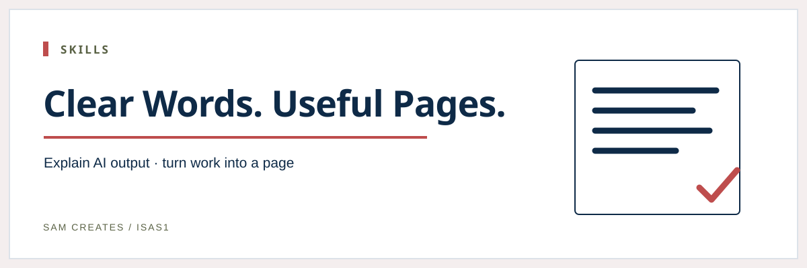
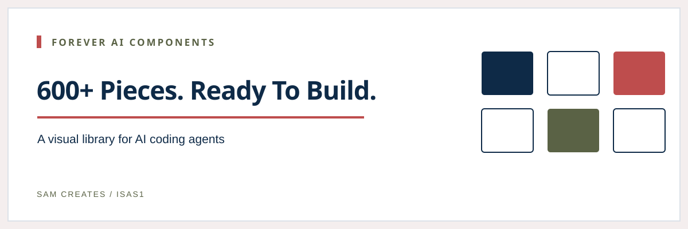
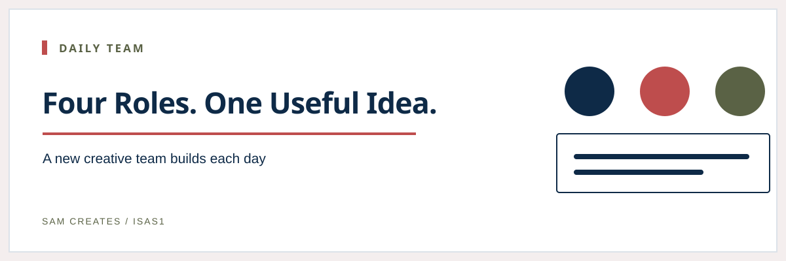
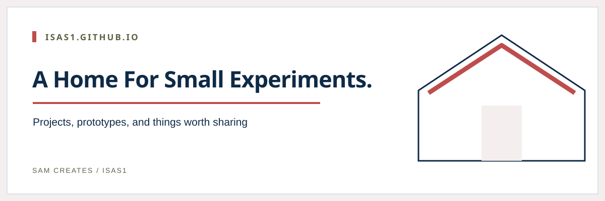

 

[Skills](https://github.com/isas1/skills)

Skills for explaining and summarising AI output: `eli5-succinct`, `simple-summary`, and `summary`.

---

[Forever AI Components](https://github.com/isas1/forever-ai-components)

600+ zero-dependency animated components. One HTML file each. Built for AI agents.

---

[Daily Team](https://github.com/isas1/daily-team)

A new four-person creative team every day, and the small web tool it built.

---

[My First Portfolio](https://github.com/isas1/isas1.github.io)

My first portfolio.

---

[All public repositories →](https://github.com/isas1?tab=repositories) · [YouTube: Sam Automates](https://www.youtube.com/@sam.automates)
